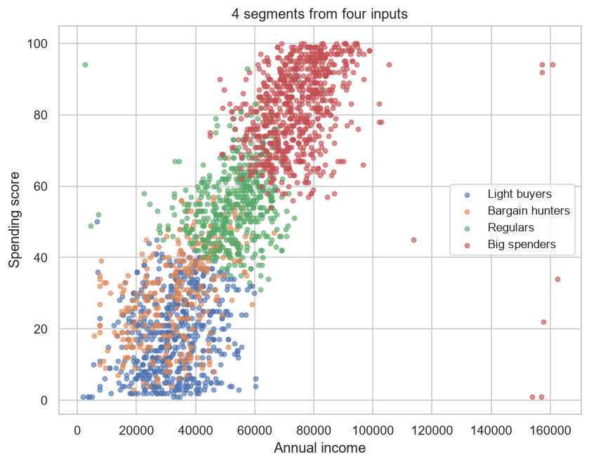

# Customer segments

Customer segmentation with K-Means clustering on annual income, spending score and purchasing behaviour. 2,215 customers of a food and drink retailer fall into four segments, each with a marketing action, and the segments are checked against offer acceptance, which they never saw. An interactive demo re-runs the clustering live and places new customers.



## Results

| Segment | Customers | Income | Spending score | Purchases | Deal share | Accepted an offer | Suggested action |
| --- | --- | --- | --- | --- | --- | --- | --- |
| Big spenders | 759 (34%) | 74,700 | 82 | 20 | 8% | 24% | Loyalty perks, premium ranges, full price |
| Regulars | 500 (23%) | 53,100 | 55 | 14 | 22% | 10% | Cross-sell and bundles |
| Bargain hunters | 365 (16%) | 34,500 | 31 | 8 | 53% | 18% | Discount campaigns |
| Light buyers | 591 (27%) | 32,600 | 18 | 5 | 28% | 6% | Cheap channels only |

- **k = 4** is the most stable choice: 10 K-Means runs from different random starts agree at 0.97 (adjusted Rand index), against 0.88 for k = 3 and 0.71 for k = 5. k = 2 has the best silhouette (0.53) but only separates big from small spenders.
- **Offer acceptance**, never an input, ranges from 6% to 24% across segments, so the segments capture real differences in behaviour.
- **Income and spending score alone** (the classic two-input version) give four bands along one diagonal, because the two rise together. Bargain hunters disappear into the two lowest bands; the two groupings agree at only 0.41.

Full tables and figures: [docs/results.md](docs/results.md). How it was done: [docs/methodology.md](docs/methodology.md).

## Run it

Needs Python 3.14+ and [uv](https://docs.astral.sh/uv/).

```bash
uv sync
uv run python main.py
uv run streamlit run app.py
```

`main.py` downloads the data from OpenML on its first run, then writes figures and tables to `outputs/`, the fitted pipeline to `models/` and `docs/results.md`.

## The demo

- **Overview**: the method and what was found.
- **Segments**: pick k and the inputs; K-Means re-runs live with a scatter plot and segment profiles.
- **Place a customer**: enter income, spending score, purchases and deal share; see the segment and the action for it.
- **Results**: the saved tables and figures.

## Layout

```
customer_segments/   data.py (download, inputs), segments.py (names and actions), report.py
pxlab/               shared engine (vendored): clustering, plots, app helpers
main.py              the full study
app.py               the Streamlit demo
docs/                methodology, results, deploy
```

## Data

"Marketing Campaign" by Rodolfo Saldanha ([Kaggle](https://www.kaggle.com/datasets/rodsaldanha/arketing-campaign), 2020), downloaded from [OpenML dataset 46940](https://www.openml.org/d/46940), listed there as public. The data isn't stored in this repo.

## License

MIT.
