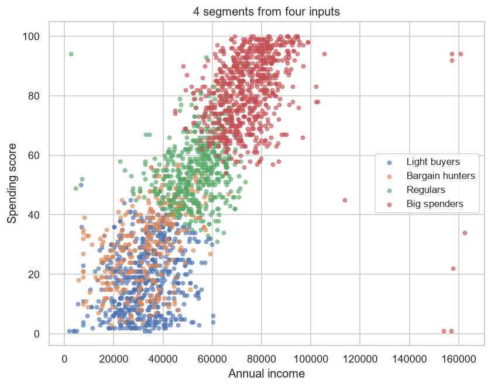
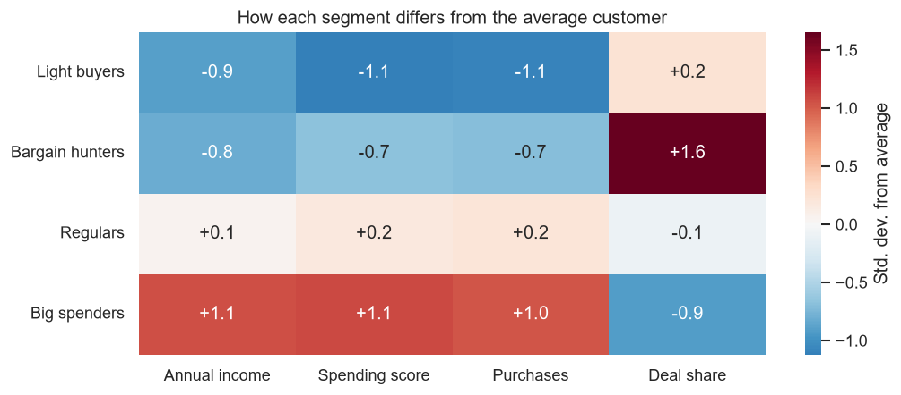
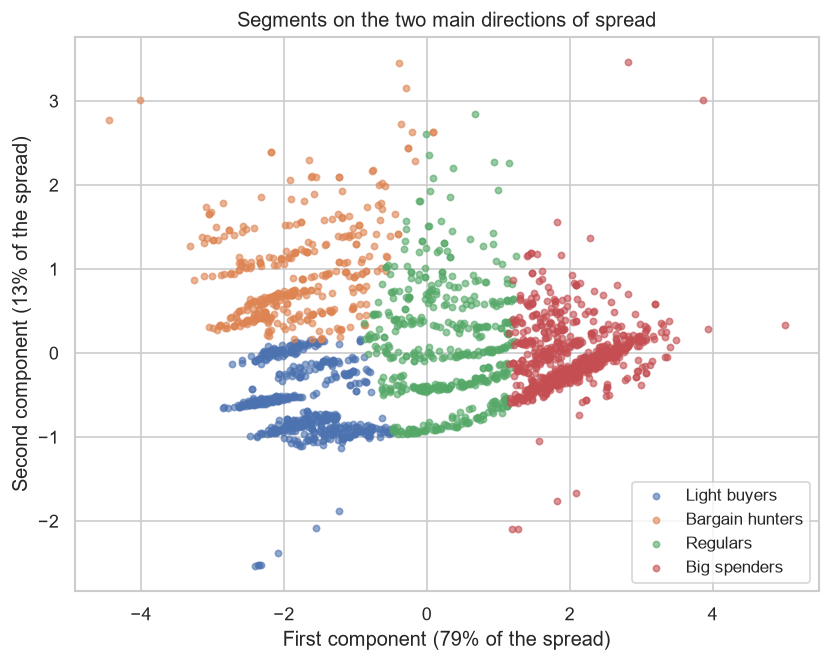
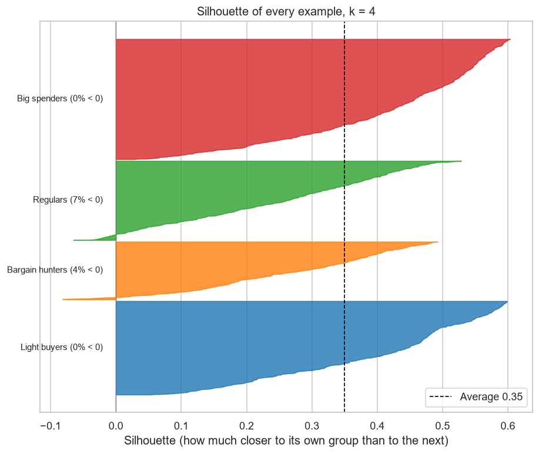
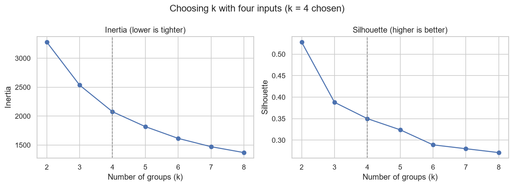
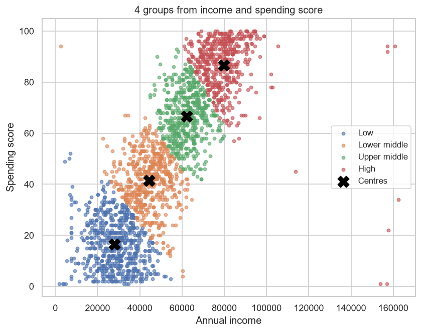

# Results

Produced by `python main.py` on 2,215 customers. K-Means with 20 random starts, seed 42.

## Segments

### Segments and what to do with each

| Segment | Customers | Share | Annual income | Spending score | Purchases | Deal share | Total spent | Accepted an offer (share) | Suggested action |
| --- | --- | --- | --- | --- | --- | --- | --- | --- | --- |
| Light buyers | 591 | 0.27 | 32600.0 | 18.47 | 4.68 | 0.28 | 59.29 | 0.06 | Cheap channels only (email, web). They buy little and rarely respond, so costly campaigns such as printed catalogues don't pay back. |
| Bargain hunters | 365 | 0.16 | 34500.0 | 31.35 | 7.55 | 0.53 | 160.58 | 0.18 | Discount and deal campaigns. Half their purchases use one, and they accept offers far more often than other low spenders. |
| Regulars | 500 | 0.23 | 53100.0 | 55.37 | 14.14 | 0.22 | 527.32 | 0.1 | Cross-sell and bundles to grow the basket: they already buy often but in mid-sized amounts. |
| Big spenders | 759 | 0.34 | 74700.0 | 81.53 | 20.06 | 0.08 | 1301.59 | 0.24 | Loyalty perks, premium ranges and early access at full price. They rarely wait for discounts, so discounting them gives margin away. |

## Validation

### What the checks found

| Finding |
| --- |
| Best k by each score: silhouette 2, Calinski-Harabasz 2, Davies-Bouldin 2; k = 4 was used. |
| Most stable group: Big spenders (mean Jaccard 0.97, very stable); least stable: Regulars (0.93, very stable). |
| Silhouette 0.350 on the real data against 0.195 on shuffled data with no relationships between inputs: the groups reflect real structure. |

### Bootstrap stability of each group (50 draws)

| Group | Mean Jaccard | Recovered in | Verdict |
| --- | --- | --- | --- |
| Light buyers | 0.96 | 1.0 | very stable |
| Bargain hunters | 0.948 | 1.0 | very stable |
| Regulars | 0.933 | 1.0 | very stable |
| Big spenders | 0.975 | 1.0 | very stable |

### Real data against shuffled data

| Real silhouette | Shuffled silhouette (mean) | Shuffled silhouette (spread) | Standard deviations above shuffled |
| --- | --- | --- | --- |
| 0.35 | 0.195 | 0.002 | 76.585 |

### Three quality scores for each k

| k | Silhouette (higher better) | Calinski-Harabasz (higher better) | Davies-Bouldin (lower better) |
| --- | --- | --- | --- |
| 2 | 0.528 | 3768.059 | 0.693 |
| 3 | 0.388 | 2760.153 | 1.046 |
| 4 | 0.35 | 2409.467 | 1.058 |
| 5 | 0.324 | 2140.021 | 1.063 |
| 6 | 0.289 | 1982.711 | 1.125 |
| 7 | 0.28 | 1847.83 | 1.114 |
| 8 | 0.271 | 1724.73 | 1.108 |

## Choosing k

### Four inputs: score for each k

| k | Inertia | Silhouette | Stability (mean) | Stability (lowest) |
| --- | --- | --- | --- | --- |
| 2 | 3278.218 | 0.528 | nan | nan |
| 3 | 2534.602 | 0.388 | 0.879 | 0.509 |
| 4 | 2075.286 | 0.35 | 0.967 | 0.955 |
| 5 | 1818.054 | 0.324 | 0.705 | 0.559 |
| 6 | 1614.49 | 0.289 | 0.757 | 0.577 |
| 7 | 1471.449 | 0.28 | nan | nan |
| 8 | 1369.347 | 0.271 | nan | nan |

### Income and spending score only: score for each k

| k | Inertia | Silhouette | Stability (mean) | Stability (lowest) |
| --- | --- | --- | --- | --- |
| 2 | 1385.385 | 0.572 | nan | nan |
| 3 | 879.355 | 0.473 | 0.939 | 0.923 |
| 4 | 696.198 | 0.404 | 0.96 | 0.904 |
| 5 | 588.132 | 0.412 | 0.648 | 0.498 |
| 6 | 490.842 | 0.377 | 0.686 | 0.467 |
| 7 | 421.228 | 0.351 | nan | nan |
| 8 | 375.311 | 0.341 | nan | nan |

## Income and spending only

### Groups from income and spending score alone

| Segment | Customers | Share | Annual income | Spending score | Total spent | Accepted an offer (share) |
| --- | --- | --- | --- | --- | --- | --- |
| Low | 635 | 0.29 | 28100.0 | 16.5 | 50.58 | 0.09 |
| Lower middle | 552 | 0.25 | 44500.0 | 41.48 | 252.79 | 0.12 |
| Upper middle | 524 | 0.24 | 62200.0 | 66.6 | 816.7 | 0.11 |
| High | 504 | 0.23 | 79700.0 | 86.61 | 1479.38 | 0.3 |

### How the two groupings compare

| Four inputs | Low | Lower middle | Upper middle | High |
| --- | --- | --- | --- | --- |
| Light buyers | 448 | 143 | 0 | 0 |
| Bargain hunters | 185 | 165 | 14 | 1 |
| Regulars | 2 | 244 | 249 | 5 |
| Big spenders | 0 | 0 | 261 | 498 |
